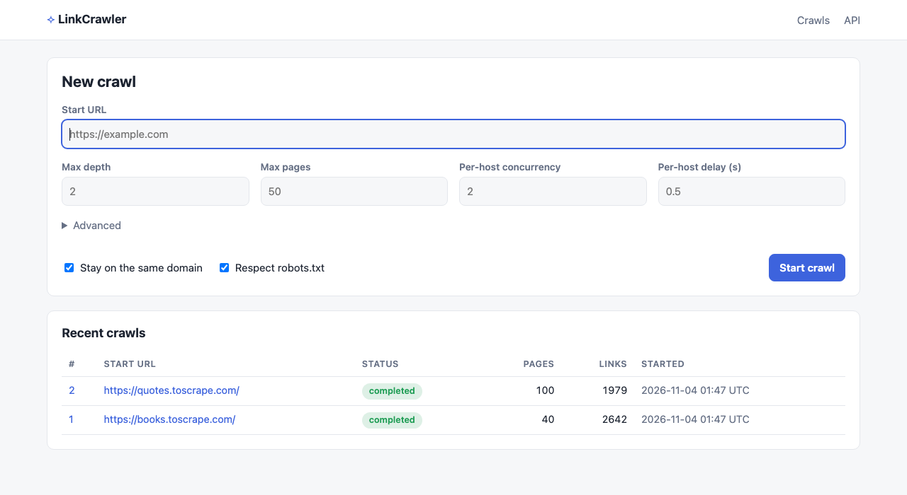
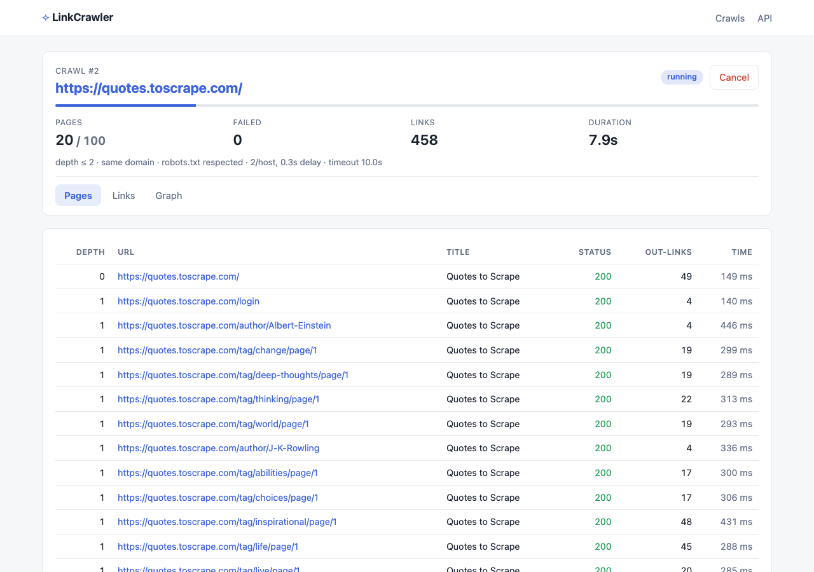
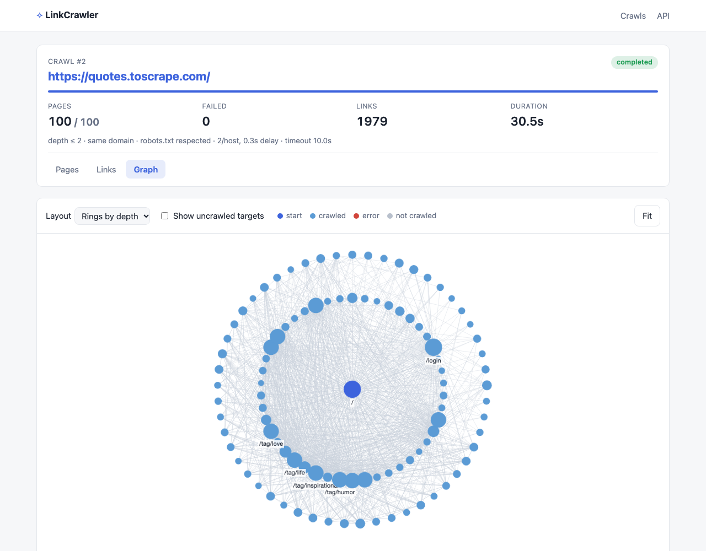
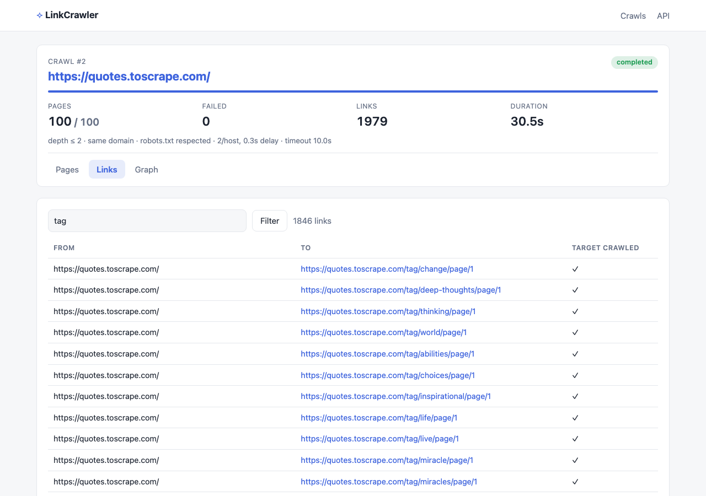

# LinkCrawler

[](https://github.com/rodferro/linkcrawler/actions/workflows/ci.yml)

A polite, asynchronous web crawler that maps the link graph of a website. Start a crawl
from the browser (or the JSON API), watch it progress live, then explore the pages as a
table, the raw edges as a filterable list, or the whole site as an interactive graph.

Built with **FastAPI**, **asyncio + httpx**, and **SQLAlchemy (async) on SQLite**.



| Live progress | Link graph |
| --- | --- |
|  |  |



## Features

- **Concurrent breadth-first crawling.** A pool of asyncio workers shares one `httpx.AsyncClient`.
- **Deduplication and URL normalization.** Relative links are resolved (honouring `<base href>`), fragments are dropped, scheme/host are lower-cased, default ports are removed, `.`/`..` segments are collapsed, trailing slashes are unified, and `http://`/`https://` variants of the same page count once.
- **Limits.** Max depth and max pages. The page budget counts *pages*, not links.
- **Same-domain option.** `www.` is treated as the same site. Off-site links are still recorded as edges, just not fetched.
- **Politeness.** `robots.txt` is fetched once per origin and parsed with `urllib.robotparser`, including `Crawl-delay`. A per-host concurrency limit and a per-host delay between request starts apply, along with a configurable timeout and User-Agent.
- **Content-type check.** Headers are read before the body. Only `text/html` / `application/xhtml+xml` is downloaded and parsed, and bodies are capped at 5 MB.
- **Background crawls.** `POST` returns immediately. The crawl runs as an asyncio task and the status page polls a JSON endpoint. You can cancel a running crawl.
- **Three views per crawl.** A pages table (depth, status, title, timing), a paginated and searchable edge list, and a Cytoscape.js graph with rings-by-depth, force-directed, and tree layouts.
- **JSON API** with OpenAPI docs at `/docs`.

## Quick start

### Local (Python 3.12+)

```bash
$(brew --prefix)/bin/python3.12 -m venv .venv   # or any Python ≥ 3.12
source .venv/bin/activate
pip install -e '.[dev]'
uvicorn linkcrawler.main:app --reload
```

Open <http://127.0.0.1:8000>. The SQLite database is created at `./data/crawler.db`
(anchored to the project root, not the working directory).

### Docker

```bash
docker compose up --build
```

The app runs on <http://localhost:8000>, and the database is kept in the `crawler-data` volume.

## Configuration

Every setting can be overridden with an environment variable (or a `.env` file) prefixed
with `CRAWLER_`. The crawl settings are defaults: each crawl can override them from the form or API.

| Variable | Default | Meaning |
| --- | --- | --- |
| `CRAWLER_DATABASE_URL` | `sqlite+aiosqlite:///<repo>/data/crawler.db` | SQLAlchemy async URL |
| `CRAWLER_USER_AGENT` | `LinkCrawler/2.0 (+https://github.com/rodferro/linkcrawler)` | Sent with every request and matched against `robots.txt` |
| `CRAWLER_REQUEST_TIMEOUT` | `10` | Seconds per request |
| `CRAWLER_MAX_PAGES` | `50` | Pages fetched per crawl |
| `CRAWLER_MAX_DEPTH` | `2` | Link hops from the start URL |
| `CRAWLER_CONCURRENCY` | `8` | Worker tasks per crawl |
| `CRAWLER_PER_HOST_CONCURRENCY` | `2` | Simultaneous requests to one host |
| `CRAWLER_PER_HOST_DELAY` | `0.5` | Minimum seconds between request starts on one host |
| `CRAWLER_MAX_BODY_BYTES` | `5242880` | HTML bodies are truncated beyond this |

## API

| Method | Path | |
| --- | --- | --- |
| `POST` | `/api/crawls` | Start a crawl and return `202` with the crawl record |
| `GET` | `/api/crawls` | Recent crawls |
| `GET` | `/api/crawls/{id}` | Status and progress counters (what the status page polls) |
| `POST` | `/api/crawls/{id}/cancel` | Cancel a running crawl |
| `GET` | `/api/crawls/{id}/pages` | Fetched pages |
| `GET` | `/api/crawls/{id}/links?q=&offset=&limit=` | Edges, filterable |
| `GET` | `/api/crawls/{id}/graph?uncrawled=false` | Nodes and edges for the graph view |

```bash
curl -X POST localhost:8000/api/crawls -H 'content-type: application/json' \
  -d '{"url": "https://quotes.toscrape.com/", "max_pages": 100, "max_depth": 2}'
```

## Architecture

```
            ┌───────────── FastAPI app (single process, one event loop) ─────────────┐
 browser ──►│ web.py (Jinja pages) ─┐                                                │
  / curl    │ api.py (JSON)  ───────┼─► CrawlManager ──create_task──► Crawler.run()  │
            │      ▲                │   (manager.py)                  (crawler.py)   │
            │      │ poll           │                                  │   │         │
            │      │                ▼                       on_page()  │   │ httpx   │
            │  repository.py ◄── SQLAlchemy async ◄── record_page ◄────┘   ▼         │
            └──────────────────────────┬───────────────────────────── RobotsCache,   │
                                       ▼                               HostThrottle  │
                                SQLite (WAL)                                         │
                         crawls ─< pages ─< links                                    │
```

**Modules** (`src/linkcrawler/`)

| File | Responsibility |
| --- | --- |
| `urls.py` | Pure functions: resolve, normalize, dedup key, same-site check |
| `crawler.py` | The engine: work queue, worker pool, `HostThrottle`, fetch and parse. It has no database code and reports each page through an async `on_page` callback. |
| `robots.py` | Async `robots.txt` fetch, cached per origin, parsed by `urllib.robotparser` |
| `manager.py` | Starts crawls as asyncio tasks, tracks them, and handles cancel and shutdown |
| `repository.py` | All SQL: create crawls, record pages and edges, queries for the views |
| `models.py` | `crawls`, `pages`, `links` tables |
| `api.py`, `web.py` | JSON and HTML routes |
| `main.py` | App factory and lifespan (DB setup, interrupted-crawl recovery, graceful shutdown) |

**Schema.** A *crawl* owns many *pages* (one row per fetched URL, with status, content type,
title, error, and timing). A *link* is a directed edge from a source page to a target URL. The
target is stored as a URL rather than a page ID because most targets are never fetched
(they're off-site, beyond the limits, or blocked by robots.txt).

### Design notes and trade-offs

- **Crawler/persistence split.** The crawler only knows about `on_page(result)`. Tests drive it with an in-memory list, the app plugs in `repository.record_page`. That's why the crawler tests need no database and run in milliseconds.
- **Termination.** Workers pull from an `asyncio.Queue`, and the crawl ends when `queue.join()` resolves. URLs are marked *seen* when they're **scheduled**, not when they're fetched, so a page linked from 50 places is queued once. The page budget is enforced at scheduling time too, so `max_pages` is exact.
- **Politeness.** `HostThrottle` holds one semaphore per host (the concurrency cap) and a "next allowed start" timestamp per host (the delay), so different hosts don't slow each other down. Timing starts *after* the throttle, so the recorded response time isn't inflated by queueing.
- **Background tasks without Redis.** Crawls are plain asyncio tasks in the web process. That keeps deployment to a single container, at the cost of horizontal scaling: a crawl lives and dies with its process. On startup, any crawl still marked `running` is flipped to `interrupted`, so the UI never shows a ghost crawl. A queue such as arq or Celery would be the next step for multi-worker deployments.
- **SQLite writes.** SQLite allows one writer at a time. Writes go through a single `asyncio.Lock`, with WAL mode and a busy timeout, so concurrent crawls never hit `database is locked`. Reads stay concurrent.
- **Timestamps.** SQLite drops timezone info, so a small `UTCDateTime` column type re-attaches UTC on load. Without it, the API emits naive timestamps that browsers read as local time.

## Development

```bash
pytest            # 65 tests: URL normalization, crawler behaviour (HTTP mocked with respx), API/UI
ruff check . && ruff format --check .
mypy              # strict
```

CI (GitHub Actions) runs lint, type checking, and tests on Python 3.12 and 3.13. It then builds
the Docker image and smoke-tests `/healthz`.

## Limitations

- **Not hardened for public deployment.** The app fetches whatever URL it is given, including internal addresses (SSRF). Put it behind auth or add an IP allow-list before exposing it.
- **No JavaScript rendering.** Links that only appear after client-side rendering are missed.
- **Integer `Crawl-delay` only.** `urllib.robotparser` ignores fractional values.
- **Graph size.** The graph view is meant for crawls of up to roughly a couple of thousand nodes.

## History

This project began as a small Flask app that stored links with `dataset`. Version 2 is a full rewrite.
See the pull request that introduced it for a before/after list of the bugs it fixed.
